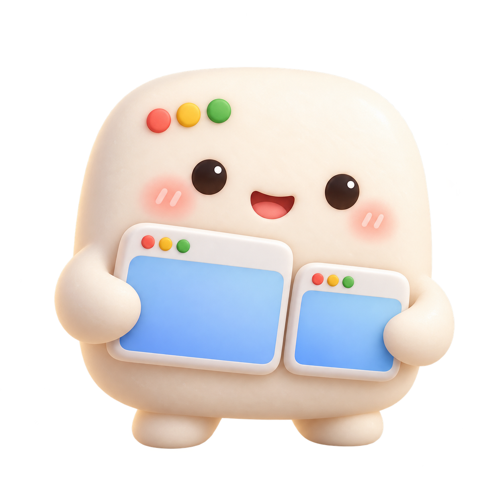

# WindowMochi

A cute macOS menu bar app that remembers your window layouts and restores them across multiple displays, with global shortcuts and multilingual support.

<p align="center">
  
</p>

## Requirements

- macOS 13 or later.
- Apple Silicon for the current build script.
- Accessibility permission to move and resize other apps' windows.
- Apple Command Line Tools with Swift 6 to build from source.

## Build and launch

```sh
git clone https://github.com/SuBoYu/windowmochi.git
cd windowmochi
./scripts/build.sh
open dist/WindowMochi.app
```

WindowMochi runs in the menu bar; it does not open a regular app window. Click the mochi icon near the top-right corner of your screen.

The build script compiles the app, creates its mascot icon, and applies a local ad-hoc signature. The app is not notarized by Apple. Rebuilding may require granting Accessibility permission again.

## Save and restore a layout

1. Choose **Grant Accessibility permission…** and enable WindowMochi in **System Settings → Privacy & Security → Accessibility**.
2. Arrange your open windows across your displays.
3. Choose **Save current layout…** and enter a name, such as Work or Meetings.
4. Move or resize your windows, then select the saved layout to restore it.

Save multiple layouts for different activities. Replacing a layout with the same name requires confirmation and preserves its position in the list.

## Global shortcuts

| Shortcut | Action |
| --- | --- |
| Control + Option + Command + 1–9 | Restore layouts 1–9 |
| Control + Option + Command + → | Restore the next layout, wrapping to the first |
| Control + Option + Command + ← | Restore the previous layout, wrapping to the last |

Shortcuts work while WindowMochi is running, including when another app is in the foreground. The menu shows layout order and the currently selected layout. Before a layout has been selected, → starts with the first layout and ← starts with the last. Layouts beyond the first nine remain available through the arrow shortcuts and menu.

Successful shortcut restores do not open a dialog. Missing windows or rejected adjustments display a report. Shortcuts are currently fixed; registration failures display a warning, and menu-based restoration remains available. The app registers specific combinations through Carbon rather than capturing general typing.

## Languages

English, Traditional Chinese, Simplified Chinese, and Japanese are included. WindowMochi follows your system language preferences by default and falls back to English for unsupported languages. Choose **Language** from the menu to switch immediately; your choice persists across launches. User-defined layout names are not translated.

UI strings live in `Sources/WindowMochi/Resources/*.json` and use stable keys with format arguments. To add a language, create a matching JSON file and register the locale in `Localization.swift`, the language menu, and the build script's `CFBundleLocalizations` list. Update the expected locales in the translation check as well.

```sh
python3 tests/check_localizations.py
```

This checks translation coverage, nonempty values, and format-argument compatibility.

## Storage and privacy

Layouts are stored locally in:

```text
~/Library/Application Support/WindowHabit/layouts.json
```

The file contains app identifiers, window titles, display identifiers, and window geometry. It is outside the source repository. Choose **Open layouts folder** to inspect it. To clear all layouts, quit the app, delete the file, and relaunch.

## Behavior and limitations

- Only open, non-minimized, non-full-screen standard windows are included. Closed apps are not launched automatically.
- Displays are matched by UUID, and geometry is restored using relative positions and sizes. If a display is missing, windows fall back to the built-in display, or another available display.
- Windows are matched within each app using titles and window order. Changed titles, duplicate titles, or reordered windows can make matching ambiguous.
- The app does not switch Spaces or recreate browser tabs.
- Some apps enforce minimum window sizes, adjust positions themselves, or reject Accessibility operations.
- Automatic restoration on display connection, launch at login, and customizable shortcuts are not yet included.

## Branding and upgrades

The WindowMochi mascot appears in the app icon, menu bar, and About dialog. `scripts/build-icon.sh` packages `assets/branding/windowmochi-mascot-v1.png` into macOS icon sizes and an ICNS file using built-in macOS tools.

The app was originally named WindowHabit. Its bundle identifier remains `local.windowhabit.app`, and its storage folder retains the old name to preserve existing language preferences and layouts. The Swift target and app bundle are now named WindowMochi. Quit the old version before opening `dist/WindowMochi.app` to avoid competing shortcut registrations.

## Validation

Release compilation, signature verification, and translation checks have passed. Global shortcuts, persisted language selection, and actual multi-display window movement still require manual verification with Accessibility permission enabled.

Manual checks:

- Save windows from two apps on different displays, change their geometry, and restore them.
- Save two differently titled windows from the same app and verify matching.
- Disconnect the external display and confirm restored windows remain visible.
- Close a saved window and check the missing-window report.
- Deny Accessibility permission and confirm the app shows guidance without moving windows.
- Switch through all four languages, check dialogs, and restart to confirm the choice persists.
- Switch between two layouts from another foreground app using number and arrow shortcuts.
- Verify cycling at both ends of the list and stable shortcut assignments after replacing a layout.
- Confirm unused number shortcuts and cycling with no layouts have no effect.
- Reserve a shortcut in another app and verify the conflict warning and menu fallback.

## Repository

[SuBoYu/windowmochi](https://github.com/SuBoYu/windowmochi) · [GitHub setup guide](docs/GITHUB_SETUP.md)
